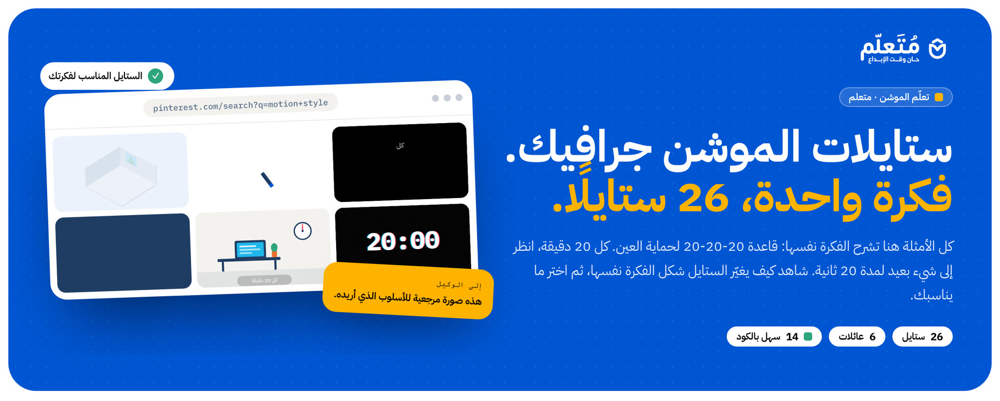
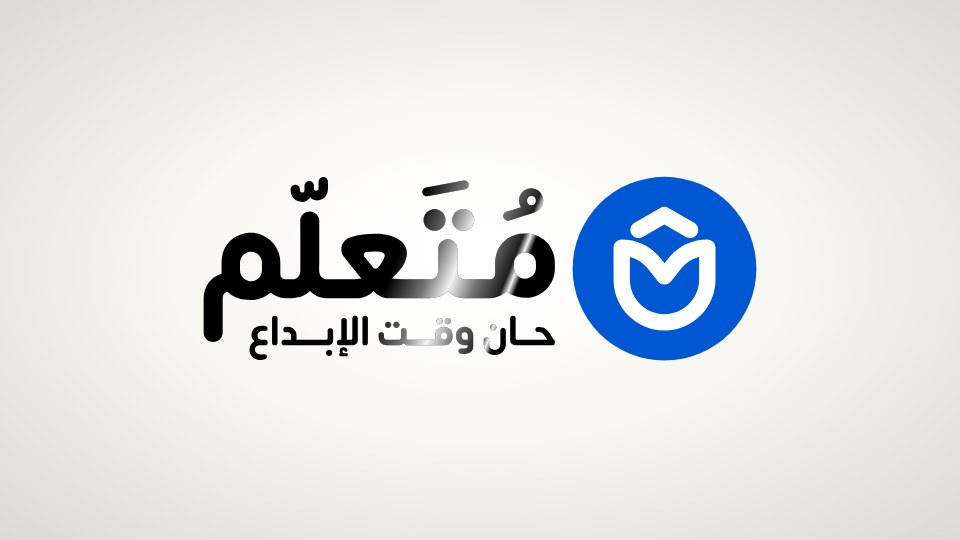

<div dir="rtl">

# Motion Starter Kit: فيديو موشن جرافيك بالكلام مع الذكاء الاصطناعي

[](https://youtu.be/yreYVMWULLc)

▶️ **[شاهد الفيديو على يوتيوب](https://youtu.be/yreYVMWULLc)**: هذا الفيديو كله صُنع بـ Remotion بالكلام مع Claude Code، وهو ستايل `plotter` في المكتبة.

> **🤖 إلى الوكيل (AI agent):** إن أعطاك المستخدم رابط هذا الريبو وطلب فيديو:
> 1. انسخ الريبو وادخل إليه: `git clone https://github.com/motalim-ai/motion-starter-kit.git`. إن كان المجلد الحالي فارغًا، أضف ` .` في آخر الأمر.
> 2. اقرأ `AGENTS.md` والتزم به، ثم اتبع `.agents/skills/motion-from-reference/SKILL.md` مرحلة بمرحلة.
> 3. افهم الستايل أولًا، ثم اسأل المستخدم كل أسئلتك مرة واحدة بكلام بسيط. لا تبنِ قبل إجاباته، ولا ترندر قبل أن يشاهد الفيديو في Remotion Studio ويوافق.
>
> 4. إن طلب **تحريك شعاره**، فاتبع `.agents/skills/logo-animation/SKILL.md` بدلًا من ذلك، والمشروع في `logo/`.
>
> **For AI agents:** if the user gave you this repo's link and asked for a video: clone it, read `AGENTS.md`, and follow `.agents/skills/motion-from-reference/SKILL.md` step by step. For an animated logo, follow `.agents/skills/logo-animation/SKILL.md` (project in `logo/`). Ask all your questions once, in simple words. Never render before the user has watched the result in Remotion Studio and approved it.

## معرض ستايلات الموشن جرافيك
[](https://motalim-ai.github.io/motion-starter-kit/gallery/)

لا تعرف أي ستايل تختار؟ افتح **[المعرض](https://motalim-ai.github.io/motion-starter-kit/gallery/)**: فيه 26 ستايلًا في 6 عائلات، وكلها تشرح الفكرة نفسها بمثال حي يتحرك، لترى الفرق بعينك. ومع كل ستايل: ما الذي يناسبه، وكلمات البحث عنه في Pinterest، وفيديو الستايل إن كان من الستايلات العشرة في هذا الريبو.

## تحريك الشعار
[](https://motalim-ai.github.io/motion-starter-kit/gallery/logo/)

**[معرض تحريك الشعار](https://motalim-ai.github.io/motion-starter-kit/gallery/logo/)**: 17 ستايلًا لتحريك الشعار في Remotion، كلها على شعار متعلم، ولكل ستايل مؤثراته الصوتية. اختر ستايلًا، ثم أعطِ الوكيل رابط الريبو (أو ملف المعرض نفسه) وشعارك بصيغة SVG:
```
https://github.com/motalim-ai/motion-starter-kit
هذا شعاري بصيغة SVG. أريده متحركًا بستايل «اللمعة» من معرض تحريك الشعار، بدون خلفية لأضعه فوق فيديوهاتي.
```
يسألك الوكيل ما ينقصه، ومنه: **بخلفية بلون محدد، أم بدون خلفية؟** النسخة بدون خلفية تُصدَّر MOV (ProRes 4444) لبرامج المونتاج، وWebM للمواقع. المشروع في `logo/`، والطريقة في `.agents/skills/logo-animation/SKILL.md`.

## الاستخدام: رابط وجملة واحدة
1. انسخ رابط الريبو: `https://github.com/motalim-ai/motion-starter-kit`
2. افتح أي وكيل برمجة (Claude Code أو Codex أو Antigravity) في مجلد فارغ.
3. أعطه الرابط، وقل له ماذا تريد. مثلًا:
```
https://github.com/motalim-ai/motion-starter-kit
أريد فيديو مدته 30 ثانية عن فوائد شرب الماء، بستايل plotter الموجود في الريبو.
```

أو لحكاية بشخصيات كرتونية:
```
https://github.com/motalim-ai/motion-starter-kit
أريد ريل مدته دقيقة يحكي قصة قصيرة عن الأمانة، بستايل doodle الموجود في الريبو.
```

بعدها يتولّى الوكيل الباقي:
1. ينسخ الريبو، ويجهّز الأدوات (ويستأذنك إن احتاج أن يثبّت شيئًا).
2. يحلّل فيديو الستايل بنفسه، ويكتب دليل أسلوبه في `STYLE.md`.
3. **يسألك** ما ينقصه، مرة واحدة: الموضوع، والمدة، واللغة، وهل تريد تعليقًا صوتيًا، أو موسيقى، أو مؤثرات صوتية.
4. يكتب السكريبت وخطة المشاهد.
5. يبني الفيديو بـ **Remotion**، مشهدًا بعد مشهد.
6. يفتح لك **Remotion Studio** لتشاهده، وتطلب أي تعديل بكلامك العادي.
7. **لا يرندر** حتى تقول «رندر».

القواعد واحدة لكل الوكلاء. لذلك يمكنك إعطاء نفس الرابط ونفس الطلب لأكثر من وكيل، ومقارنة ما يصنعه كل واحد.

## الستايلات
في الريبو عشرة ستايلات جاهزة. اذكر اسم أحدها في طلبك:

| الاسم | المعاينة | يناسب |
|---|---|---|
| `plotter` |  | شرح فكرة أو موضوع تقني: قلم يرسم على ورق مربعات، وكلمات تضيء مع الصوت. عرضي 16:9. |
| `doodle` |  | حكاية أو قصة: شخصيات كرتونية مرسومة بالحبر تمشي وتتكلم في عالم واحد بلا قطع. طولي 9:16 للريلز. |
| `whiteboard` |  | درس أو شرح خطوة بخطوة: ماركر يرسم على سبورة بيضاء، ويلوّن، والكاميرا تقترب من كل جزء. عرضي 16:9. |
| `chalkboard` |  | درس رياضيات أو علوم: طباشيرة ترسم على سبورة خضراء، مع إثبات بصري متحرك. عرضي 16:9. |
| `stickman` |  | فكرة أو نصيحة بقصة كوميدية: شخصية عصوية مرنة بوجه معبّر، ومواقف ومؤثرات. عرضي 16:9. |
| `isometric` |  | شرح رحلة أو نظام من عدة مراحل: عالم أيزومتريك ملوّن بمناطق مختلفة، والكاميرا تتبع ما يتحرك بينها. عرضي 16:9. |
| `fake3d` |  | فكرة ملهمة أو افتتاحية فنية: أشياء مسطّحة تلف بعمق ثلاثي الأبعاد، في لقطة واحدة تنتقل بين المشاهد بلا قطع. عرضي 16:9. |
| `infographic` |  | أرقام وإحصاءات بأسلوب عروض Apple: خلفية سوداء، وأرقام ضخمة تدور كالعدّاد، ورسوم تتحول من شكل لآخر. عرضي 16:9. |
| `map-journey` |  | رحلة أو حدث تاريخي على خريطة قديمة بزاوية سينمائية: خط رحلة يُرسم، وقافلة تمشي، وأعلام ومعلومات عند كل محطة. عرضي 16:9. |
| `product` |  | إعلان منتج أو تطبيق بأسلوب شركات التقنية: كلمات ضخمة تتحرك، وخانة طلب بإطار نيون، وواجهة البرنامج في منظور ثلاثي الأبعاد. عرضي 16:9. |

التفاصيل، وطريقة إضافة ستايل جديد، في [styles/README.md](styles/README.md).

**عندك فيديو يعجبك؟** ضعه في `reference/` بدل اختيار ستايل، وسيصنع الوكيل فيديو بنفس أسلوبه.

## المتطلبات
يتحقق منها الوكيل بنفسه في البداية، ويعرض أن يثبّت الناقص منها:

| الأداة | لماذا |
|---|---|
| Node.js 18+ | Remotion |
| ffmpeg | تحليل الفيديو والصوت |
| uv | تشغيل سكريبتات Python دون إعداد |

إن اخترت تعليقًا صوتيًا، فأول مرة يُستخرج فيها توقيت الكلمات يُحمَّل PyTorch وموديل المحاذاة، ومجموعهما نحو 2 جيجا. وبعدها تعمل الأداة دون إنترنت. وأول صورة أو معاينة يرسمها Remotion تحمّل متصفحًا صغيرًا (نحو 90 ميجا) مرة واحدة.

## لكل وكيل
| الوكيل | ماذا يقرأ |
|---|---|
| **Claude Code** | `CLAUDE.md`، والسكيل من `.claude/skills/` |
| **Codex** | `AGENTS.md`، والسكيل من `.agents/skills/` |
| **Antigravity** | `AGENTS.md` و`GEMINI.md`، والسكيل من `.agents/skills/` |

وإن فتحت المشروع بعد نسخه، فيكفي أن تقول: «أريد فيديو عن ... بستايل plotter»، أو «... بستايل doodle»، أو «... بستايل whiteboard»، أو «... بستايل chalkboard»، أو «... بستايل stickman»، أو «... بستايل isometric»، أو «... بستايل fake3d»، أو «... بستايل infographic»، أو «... بستايل map-journey». وللمزيد من الأمثلة: [PROMPT.md](PROMPT.md).

## خريطة المشروع
```
styles/             مكتبة الستايلات: لكل ستايل فيديو ومعاينة
gallery/            معرض الستايلات: صفحة تُفتح في المتصفح، فيها 26 ستايلًا بأمثلة حية
  logo/             معرض تحريك الشعار: 17 ستايلًا بفيديو لكل ستايل، وطريقة بناء كل ستايل للوكيل
reference/          أو ضع هنا فيديو مرجعيًا من عندك
AGENTS.md           القانون: القواعد لكل الوكلاء
CLAUDE.md           يستورد AGENTS.md لـ Claude Code
GEMINI.md           يستورد AGENTS.md لـ Antigravity
PROMPT.md           أمثلة على الطلبات
.agents/skills/motion-from-reference/
  SKILL.md          الطريقة، مرحلة بمرحلة
  references/       الأسئلة، وقالب دليل الأسلوب، وقواعد Remotion والعربية والصوت والمراجعة
  scripts/          analyze.py (تحليل الستايل)، وalign.py (توقيت الكلمات)، وsfx.py (مؤثرات)، وmusic.py (موسيقى)
.agents/skills/logo-animation/
  SKILL.md          تحريك الشعار، مرحلة بمرحلة
  references/       طريقة بناء كل ستايل، وقواعد الكلمة العربية
.claude/skills/     نفس السكيلات لـ Claude Code
video/              مشروع Remotion (تُبنى فيه المشاهد)
logo/               مشروع Remotion لتحريك الشعار
  public/logo/      ضع هنا شعارك بصيغة SVG
  src/styles/       الستايلات المبنية لشعارك (ومثال «اللمعة» جاهز)
  reference/motalim/ كود الستايلات السبعة عشر على شعار متعلم، وصور موكاب الهيرو
```

ويكتب الوكيل في جذر المشروع: `STYLE.md` و`PLAN.md` و`script.txt`، وفي `analysis/` نتائج تحليل الستايل.

## الأوامر (داخل `video/`)
| الأمر | ماذا يفعل |
|---|---|
| `npm run studio` | يفتح Remotion Studio للمعاينة |
| `npm run stills -- 3 7.5` | صور ثابتة عند ثوانٍ محددة |
| `npm run render -- --approved` | الرندر الكامل، بعد موافقتك فقط |

## أوامر تحريك الشعار (داخل `logo/`)
| الأمر | ماذا يفعل |
|---|---|
| `npm run split` | يقسّم الشعار (`public/logo/logo.svg`) إلى أجزاء |
| `npm run sfx` | يصنع المؤثرات الصوتية بالكود |
| `npm run skeleton -- --group word=p8` | هيكل حروف الكلمة، لستايلات الكتابة والتحوّل |
| `npm run studio` | يفتح Remotion Studio للمعاينة |
| `npm run stills -- --id LightSweep 1 2 4` | صور ثابتة عند ثوانٍ محددة |
| `npm run render -- --approved --id LightSweep` | MP4 بالخلفية، بعد موافقتك فقط |
| `npm run render -- --approved --id LightSweep --alpha` | بدون خلفية: MOV وWebM بشفافية |

## عن المرجع
- استخدم فيديوهات من حقك أن تتعلم منها.
- الوكيل يأخذ **الأسلوب** فقط، ولا ينسخ الشعارات ولا النصوص ولا الصور.

## الرخصة
MIT: استخدمه وعدّله وانشره بحرية. انظر [LICENSE](LICENSE).

</div>
